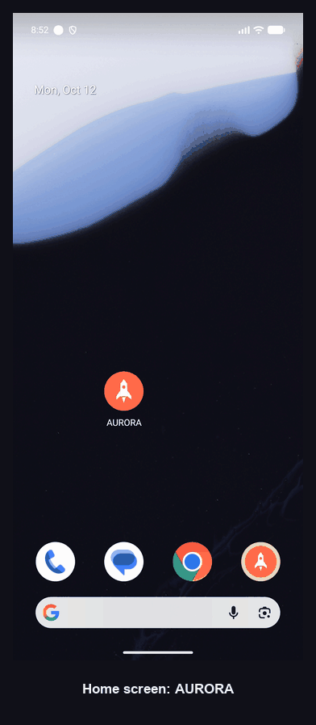
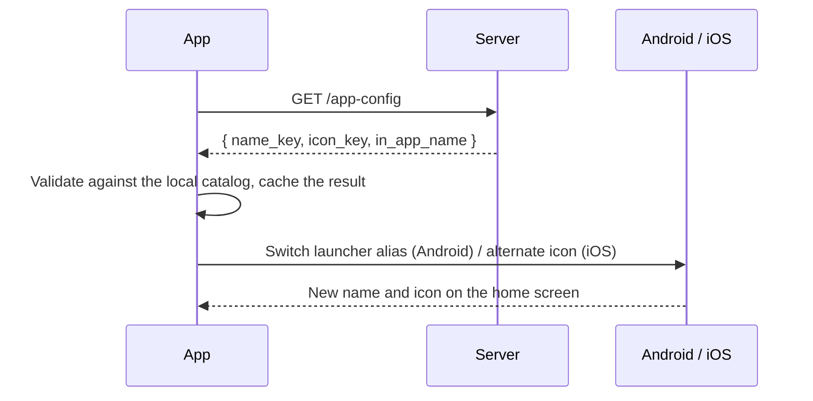
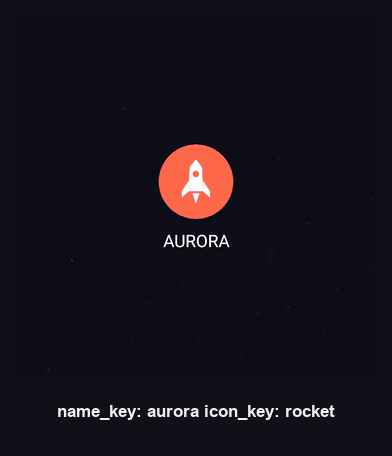
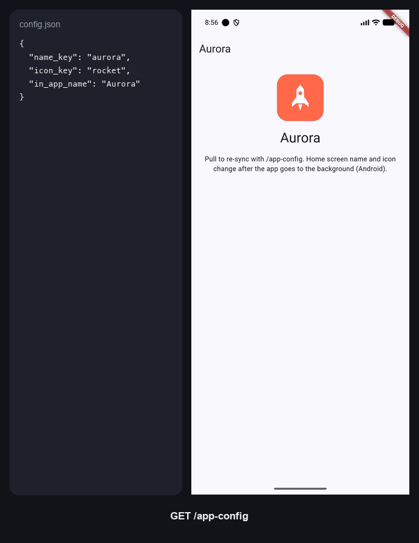
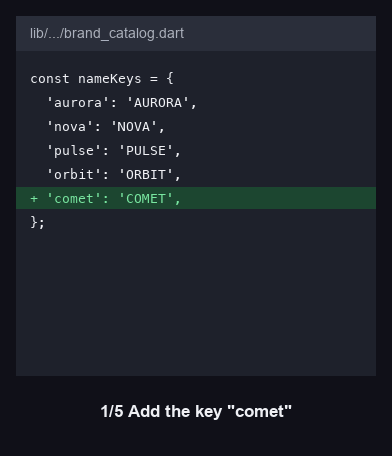

# 🚀 Brand Switcher

**Change your app's name and icon from the server. No new build, no store review, no user update.**

[](https://flutter.dev)
[](#getting-started)
[](#getting-started)
[](LICENSE)



## How it works

Every brand ships inside the app. The server only picks which one is active.



- **Android:** each name × icon pair is an `activity-alias`. The app enables one and disables the rest.
- **iOS:** icons are alternate app icons (`AppIcon-<key>`), switched with `setAlternateIconName`.

## Example brands

| Name   | Icon   |
|--------|--------|
| AURORA | rocket |
| NOVA   | star   |
| PULSE  | heart  |
| ORBIT  |        |

Name and icon are independent, so any name can go with any icon.



## No server required

The app works without a backend. It starts as **AURORA** with the **rocket** icon.

To control it remotely, connect your own server. It needs one endpoint:

```http
GET /app-config
```

```json
{
  "name_key": "nova",
  "icon_key": "star",
  "in_app_name": "Nova"
}
```

Point the app at it:

```sh
cp env/example.json env/dev.json   # set API_URL to your server
flutter run --dart-define-from-file=env/dev.json
```

### Mock server for local demos

```sh
dart run tools/mock_server/server.dart
flutter run   # debug builds use localhost:8080 (10.0.2.2:8080 on the Android emulator)
```

Edit `tools/mock_server/config.json`, pull to refresh in the app, and watch it switch.



## Getting started

```sh
flutter pub get
flutter run
```

- **Android:** the new name and icon apply after the app goes to the background.
- **iOS:** the system shows a confirmation alert when the icon changes. The home screen name is fixed at build time (`ios/Flutter/Brand.xcconfig`); only the icon switches at runtime.

## Project structure

```text
lib/
  app/              MaterialApp and dependency wiring
  core/             build-time config and theme
  features/brand/
    domain/         business rules, no HTTP or platform code
    data/           API client, cache, method channels
    presentation/   UI and view model
```

## Security

- **No secrets in the app.** `--dart-define` values are compiled in and readable from the APK/IPA.
- **Local files stay local.** `env/*.json` and signing files (`key.properties`, `*.jks`) are git-ignored.
- **Safe links only.** Links from the server open only with `https`, `http` or `itms-services`.
- **Unknown keys are ignored.** A name or icon the app doesn't ship with never reaches the launcher.

## Adding a new name or icon

Keys are append-only: never rename or remove one a user may have active.

| File | Purpose |
|------|---------|
| `lib/features/brand/domain/brand_catalog.dart` | Keys the Dart side accepts |
| `android/app/build.gradle.kts` | Gradle registry, generates alias placeholders |
| `android/app/src/main/AndroidManifest.xml` | One `activity-alias` per name × icon pair |
| `android/app/src/main/res/values/strings.xml` | Home screen names |
| `android/.../BrandSwitcher.kt` | Android key lists |
| `ios/Runner/AppDelegate.swift` | iOS icon keys |
| `ios/Flutter/Icons.xcconfig` | Alternate icon names for the asset catalog |
| `assets/icons/<key>.png` | Icon shown inside the app |



## Use cases

- **Seasonal branding:** a holiday icon for December, back to normal in January.
- **A/B testing:** try names and icons on different user groups.
- **White-label:** one codebase, a different brand per client.
- **Limited-time campaigns:** switch on for a launch, switch off after.

---

If this saved you some time, give it a ⭐
